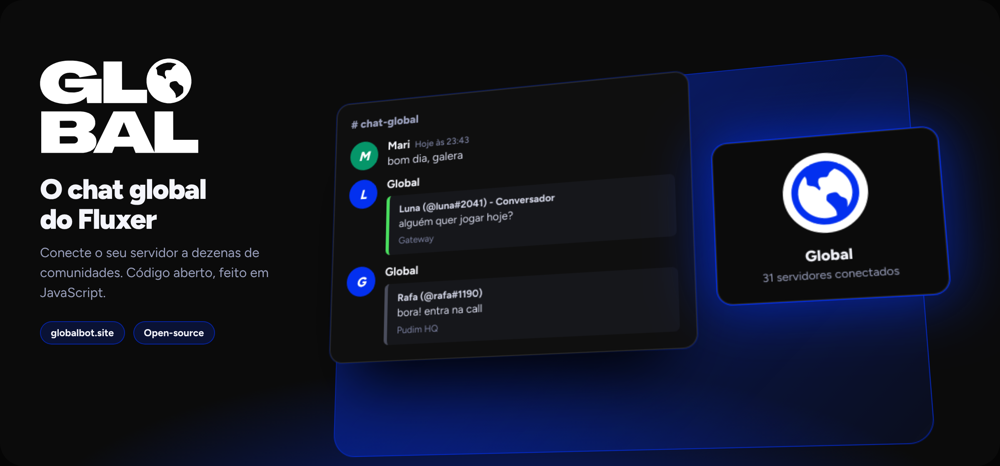
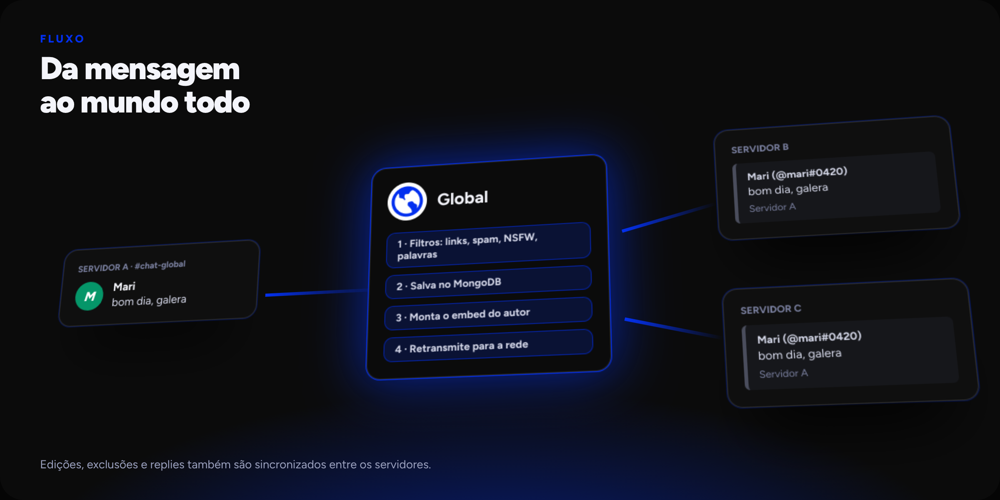
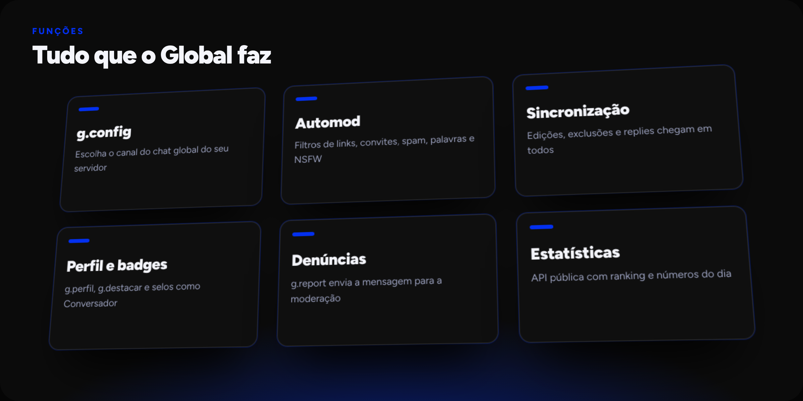
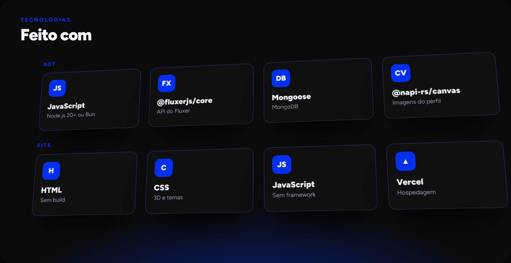

<div align="center">


[](https://globalbot.site)
[](https://github.com/Global-APP/global)
[](https://fluxer.gg/hDYAW1OU)
[](https://polyformproject.org/licenses/noncommercial/1.0.0/)

</div>

> [!NOTE]
> Este repositório é o **site** do Global. O código do bot fica em [Global-APP/global](https://github.com/Global-APP/global).

# Global

O chat global do [Fluxer](https://fluxer.app). Cada servidor escolhe um canal, e as mensagens dele chegam aos canais globais de todas as outras comunidades.

<a href="https://globalbot.site">
  
</a>

## Sobre

O site apresenta o bot, mostra uma demonstração do chat em 3D, lista os servidores parceiros e exibe as estatísticas em tempo real. É feito só com HTML, CSS e JavaScript, sem framework e sem etapa de build.

## Como o chat funciona



Quando alguém escreve no canal global do servidor, o bot passa a mensagem pelos filtros, guarda no banco, monta um embed com o autor e envia para a rede. Edições, exclusões e replies também são sincronizados.

## Funções



## Tecnologias



## Páginas

| Página | Arquivo | O que mostra |
| --- | --- | --- |
| Início | `index.html` | Recursos, demonstração do chat, código aberto e como usar |
| Parceiros | `parceiros.html` | Cards 3D com as comunidades parceiras |
| Estatísticas | `estatisticas.html` | Mensagens de hoje, servidores conectados, membros e ranking |

## Estrutura

```
Global-Site/
├── index.html
├── parceiros.html
├── estatisticas.html
├── vercel.json
├── css/style.css
├── js/
│   ├── common.js          links, tema, menu e funções compartilhadas
│   ├── home.js            página inicial
│   ├── partners-data.js   lista de parceiros
│   ├── partners.js        cards dos parceiros
│   └── stats.js           estatísticas e ranking
└── assets/
    ├── wordmark.svg
    ├── global.png
    ├── partners/          ícones dos parceiros
    └── readme/            imagens deste README
```

## Detalhes do site

**Tema.** Modo escuro e claro, com a escolha salva no navegador.

**Links.** Convite, suporte e GitHub ficam no objeto `LINKS`, no começo de `js/common.js`.

**Estatísticas.** A página busca os números na API pública do bot e atualiza a cada 60 segundos. O endereço fica em `STATS_URL`, no começo de `js/stats.js`. Se a API estiver fora do ar, aparece um aviso no lugar.

### Adicionar um parceiro

Coloque o ícone (imagem, GIF ou vídeo `.mp4`/`.webm`) em `assets/partners/` e adicione um bloco em `js/partners-data.js`:

```js
{
  name: "Nome do servidor",
  description: "Uma frase sobre a comunidade.",
  invite: "https://fluxer.gg/codigo",
  icon: "assets/partners/icone.png",
  accent: "#0330ef"
}
```

Campos opcionais: `button` (cor do botão), `label` (texto do botão) e `letter` (letra usada se o ícone não carregar).

## Rodar localmente

Não há nada para instalar. Abra o `index.html` no navegador, ou use um servidor estático para testar as URLs sem `.html`:

```sh
npx serve .
```

## Publicação

O site é hospedado na [Vercel](https://vercel.com) com o framework definido como **Other**. O `vercel.json` ativa as URLs limpas, e cada commit na branch principal publica uma nova versão.

## Paleta

| Cor | Valor |
| --- | --- |
| Oficial | `#0330ef` |
| Preto | `#0B0B0B` |
| Cinza escuro | `#0F0F0F` |

Títulos em **Figtree** e textos em fonte sans-serif do sistema.

## Licença

Distribuído sob a [PolyForm Noncommercial 1.0.0](https://polyformproject.org/licenses/noncommercial/1.0.0/).

<div align="center">

Criado por xMqR · Apoiado financeiramente por Joao.

</div>
