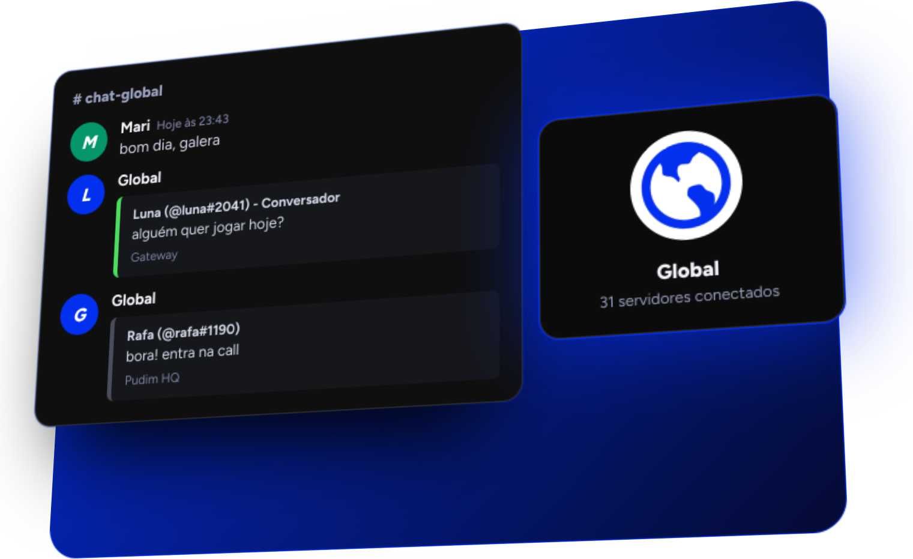

<div align="center">

<a href="https://globalbot.site"></a>

# Global

O chat global do [Fluxer](https://fluxer.app). Conecte o seu servidor a dezenas de comunidades, com código aberto.

[](https://globalbot.site)
[](https://github.com/Global-APP/global)
[](#tecnologias)
[](https://vercel.com)
[](https://polyformproject.org/licenses/noncommercial/1.0.0/)

<br>

<a href="https://globalbot.site"></a>

</div>

> [!NOTE]
> A imagem acima é fícticia, somente para representar o fluxo do chat. Este repositório é o **site** do Global. O código do bot fica em [Global-APP/global](https://github.com/Global-APP/global).

<br>

<h2 align="center">Sobre</h2>

<p align="center">
O site apresenta o bot, mostra uma demonstração do chat em 3D, lista os servidores parceiros<br>
e exibe as estatísticas em tempo real. É feito só com HTML, CSS e JavaScript,<br>
sem framework e sem etapa de build.
</p>

<br>

<h2 align="center">Como o chat funciona</h2>

<div align="center">

| Etapa | O que acontece |
| :---: | --- |
| **1** | Alguém escreve no canal global do servidor |
| **2** | O bot passa a mensagem pelos filtros: links, convites, spam, palavras e NSFW |
| **3** | A mensagem é guardada no banco de dados |
| **4** | O bot monta um embed com o autor e o nome do servidor |
| **5** | O embed é enviado para os canais globais de todas as comunidades conectadas |
| **6** | Edições, exclusões e replies são sincronizados entre os servidores |

</div>

<br>

<h2 align="center">Funções do bot</h2>

<div align="center">

| Função | Descrição |
| --- | --- |
| `g.config` | Escolhe o canal onde o chat global aparece |
| `g.automod` | Ajusta os filtros automáticos do servidor |
| `g.pausar` · `g.retomar` | Pausa e retoma a conexão com o chat |
| `g.desconectar` | Remove o servidor da rede |
| `g.perfil` · `g.destacar` | Perfil do usuário e destaque de mensagens |
| `g.report` | Envia uma mensagem para a moderação |
| `g.botinfo` · `g.ping` · `g.ajuda` | Informações, latência e lista de comandos |

</div>

<br>

<h2 align="center">Páginas do site</h2>

<div align="center">

| Página | Arquivo | O que mostra |
| --- | --- | --- |
| Início | `index.html` | Recursos, demonstração do chat, código aberto e como usar |
| Parceiros | `parceiros.html` | Cards 3D com as comunidades parceiras |
| Estatísticas | `estatisticas.html` | Mensagens de hoje, servidores conectados, membros e ranking |

</div>

<br>

<h2 align="center" id="tecnologias">Tecnologias</h2>

<div align="center">

| Parte | Tecnologias |
| --- | --- |
| Site | HTML, CSS e JavaScript puro, hospedado na Vercel |
| Bot | JavaScript (Node.js 20+ ou Bun), `@fluxerjs/core`, Mongoose e MongoDB, `@napi-rs/canvas` |

</div>

<br>

<h2 align="center">Rodar localmente</h2>

<p align="center">Não há nada para instalar. Abra o <code>index.html</code> no navegador, ou use um servidor estático para testar as URLs sem <code>.html</code>:</p>

```sh
git clone https://github.com/Global-APP/Global-Site
cd Global-Site
npx serve .
```

<br>

<h2 align="center">Publicação</h2>

<p align="center">
O site fica na <a href="https://vercel.com">Vercel</a> com o framework definido como <b>Other</b>.<br>
O <code>vercel.json</code> ativa as URLs limpas, e cada commit na branch principal publica uma nova versão.
</p>

<br>

<h2 align="center">Configuração</h2>

<div align="center">

| Onde | O quê |
| --- | --- |
| `js/common.js` | Objeto `LINKS`: convite, suporte e GitHub |
| `js/stats.js` | `STATS_URL`: endereço da API de estatísticas do bot |
| `js/partners-data.js` | Lista de parceiros |

</div>

<br>

<h2 align="center">Adicionar um parceiro</h2>

<p align="center">Coloque o ícone (imagem, GIF ou vídeo <code>.mp4</code>/<code>.webm</code>) em <code>assets/partners/</code> e adicione um bloco em <code>js/partners-data.js</code>:</p>

```js
{
  name: "Nome do servidor",
  description: "Uma frase sobre a comunidade.",
  invite: "https://fluxer.gg/codigo",
  icon: "assets/partners/icone.png",
  accent: "#0330ef"
}
```

<p align="center">Campos opcionais: <code>button</code> (cor do botão), <code>label</code> (texto do botão) e <code>letter</code> (letra usada se o ícone não carregar).</p>

<br>

<h2 align="center">Cores</h2>

<div align="center">

| Uso | Cor |
| --- | --- |
| Oficial |  |
| Fundo |  |
| Cartões |  |

</div>

<p align="center">Títulos em <b>Figtree</b> e textos em fonte sans-serif do sistema.</p>

<br>

<h2 align="center">Estrutura</h2>

```
Global-Site/
├── index.html
├── parceiros.html
├── estatisticas.html
├── vercel.json
├── css/style.css
├── js/
│   ├── common.js          links, tema, menu e funções compartilhadas
│   ├── home.js            página inicial
│   ├── partners-data.js   lista de parceiros
│   ├── partners.js        cards dos parceiros
│   └── stats.js           estatísticas e ranking
└── assets/
    ├── wordmark.svg
    ├── global.png
    ├── partners/          ícones dos parceiros
    └── readme/            imagem deste README
```

<br>

<h2 align="center">Licença</h2>

<p align="center">
Distribuído sob a <a href="https://polyformproject.org/licenses/noncommercial/1.0.0/">PolyForm Noncommercial 1.0.0</a>.
</p>

<br>

<p align="center">Criado por xMqR · Apoiado financeiramente por Joao.</p>
